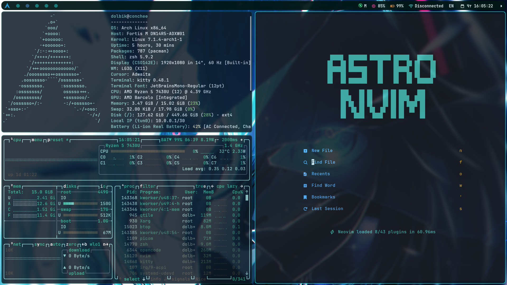

# dotfiles

GNU Stow-managed configs for the Arch rice. Each top-level directory (except
`.backups/`) is a stow **package**: its contents mirror the paths they should
have in `$HOME`.

## Apply everything

```sh
cd ~/dotfiles
stow -v */              # or list packages explicitly
```

Stow is run from this directory and targets `$HOME` by default, so
`qtile/.config/qtile/config.py` becomes `~/.config/qtile/config.py`.

## Common commands

```sh
stow -n -v <package>    # dry run
stow -v <package>       # install / restow
stow -D -v <package>    # remove the symlinks (restores original layout)
```

## Packages

| Package                | Manages                            |
| ---------------------- | ---------------------------------- |
| `qtile`                | Qtile config, autostart, bar icons |
| `kitty`                | Terminal config + theme            |
| `nvim`                 | AstroNvim config                   |
| `rofi`                 | Launcher config                    |
| `picom`                | Compositor config                  |
| `fastfetch`            | Fetch config                       |
| `btop`                 | System monitor config + Gotham theme |
| `yazi`                 | File manager config + plugins      |
| `networkmanager-dmenu` | Network menu config                |
| `gsimplecal`           | Calendar config                    |
| `gtk`                  | GTK 3/4 settings                   |
| `mimeapps`             | Default applications               |
| `pavucontrol`          | Pavucontrol window config          |
| `qt`                   | Qt app config                      |
| `zsh`                  | `.zshrc`                           |
| `git`                  | `.gitconfig`                       |
| `scripts`              | `~/.local/bin/blur-lock`           |

## Notes

- `.backups/` holds pre-stow backup files and is gitignored.
- `gtk/.config/gtk-{3,4}.0/settigs.ini` keeps its original (misspelled)
  filename; GTK itself is themed via `gsettings`/dconf.
- `scripts/.local/bin/blur-lock` captures with `x11grab` raw, blurs with `ffmpeg`,
  and locks with `i3lock` (`-u` disables the unlock indicator). `xss-lock` in
  `qtile/autostart.sh` calls it on idle and before suspend.
